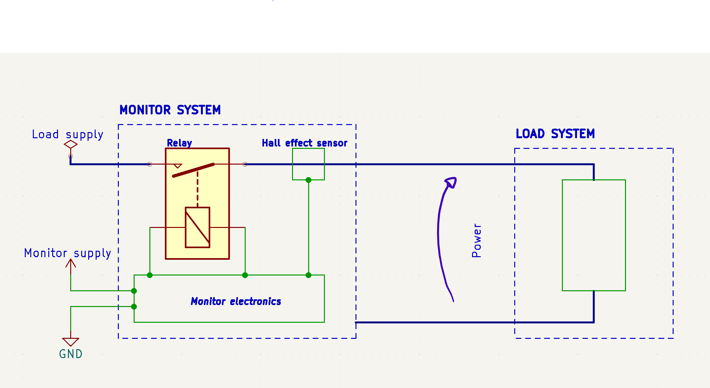

# Recruitment for E-Agle TRT | Electronics division

Welcome to the recruitment _test_ for the electronics team of E-Agle Trento Racing Team.

This test gives us an initial understanding of applicants' abilities without the pressure of a formal exam.

It also introduces you to the tools we use, so you can get up to speed with the team's workflow before you need to use them under pressure.

## What we'll look into

- Schematic quality: clear connections, consistent labels, tidy organisation into functional blocks and good KiCad practices.
- Circuit correctness: operation that meets the requirements, suitable components and calculations that support the design.
- Technical reasoning: clear explanations of the circuit architecture, component choices and sizing that demonstrate your understanding.
- Documentation quality: clear and complete explanations, calculations and verification, consistent with the submitted schematic.
- Board layout quality: suitable component placement and routing, manufacturing constraints and good PCB design practices.
- `git` usage: fork, branch, clone, commit, push, pull.

## Assignment

Develop an overcurrent monitoring system (**monitor**) to perform plausibility checks on a secondary system (**load**).

### Overview

The **monitor** has the following specifications:

- It is powered by an unstable DC supply ranging from 9 V to 17 V.
- It has a normally open relay connected in series with the load.
- It uses a Hall-effect sensor to measure the current through the load.

The **load** has the following specifications:

- Voltage range: 24 V to 48 V.
- Current range: -3 A to 25 A.

### Specs

The **monitor** must ensure that the relay is open if the power drawn by the **load** exceeds 500 W.

Once the relay opens because of excessive power, it must remain open until the **monitor** is power cycled.

No programmable logic is allowed.

The Hall-effect sensor may be selected from the Allegro ACS781xLR family. Other sensors may be used if they meet the specifications and you demonstrate their suitability.

The following diagram shows the system:

## KiCad instructions

- Include at least one hierarchical sheet in the schematic.
  - _A hierarchical sheet is not necessary for a project this small, but it lets you learn how to use hierarchy without the complexity of a larger assignment._

- Write the required calculations directly on the schematic as text notes near the relevant circuit blocks. Include formulas, numerical substitutions, units and results, not just the final component values.

- Include connectors, power-supply decoupling, relay drivers and the necessary protection circuits.

- Use [Mouser](https://www.mouser.com/) as the reference catalogue for component selection. Record the manufacturer, manufacturer part number and Mouser part number or product link in the schematic fields for each selected physical component, so they can be exported in the BOM.

- Run the electrical rules check (ERC), fix unintended errors and explain any remaining warnings.

- Use JLCPCB as the manufacturing reference.

## General instructions

- You may use AI tools to help you understand concepts, but you must design the circuit, draw the schematic, carry out the calculations and write the documentation yourself. Any submitted work found to be AI-generated, or that you cannot explain when asked, will result in disqualification and your application will not be considered. Practices that demonstrate your authorship, such as meaningful progress commits and notes explaining your design decisions, will be appreciated.
- Create a repository on your GitHub account and copy this project into it. If you do not have an account, create one. **Do not clone this repository!**
- Use the existing KiCad project as a starting point, or create a new one for this assignment.
- Create a branch named `name_surname` from `master` and commit your progress on that branch.
- Commit your progress throughout the assignment. **Do not commit only the finished project.**
- When you are done, export the schematic inside `docs/`.
- Export a bill of materials (BOM) from KiCad as a CSV file inside `docs/`. Include component references, quantities, values, manufacturers, manufacturer part numbers and Mouser part numbers or product links.
- Include a short explanation of the circuit, component choices and calculations inside `docs/`, together with annotated timing diagrams or simulations covering normal operation, excessive power, fault memory and power cycling. Simulations are not mandatory; explain how the schematic produces the expected behaviour.
- Export the production Gerber files inside `output/`.
- If you have not already done so, submit your [application form](https://eagletrt.it/apply).
- If you have questions, contact [electronics@eagletrt.it](mailto:electronics@eagletrt.it).
- You can also visit our lab on floor -2 of Povo 2 if we are slow to reply.
- You have **2 weeks (14 days)** to work on this project. **This is a firm deadline; meeting it is part of the assessment.**

## Links

- [Website](https://www.eagletrt.it)
- [Instagram](https://www.instagram.com/eagletrt)
- [LinkedIn](https://www.linkedin.com/company/eagletrentoracingteam)
